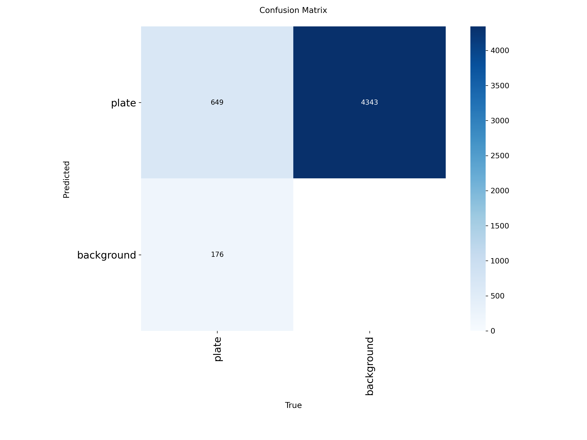
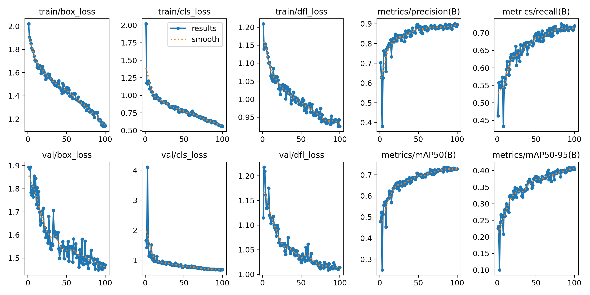
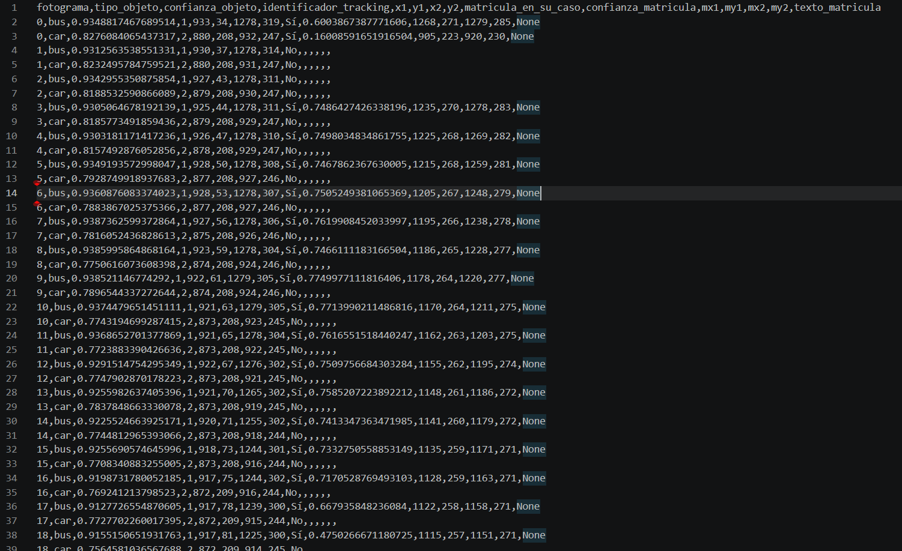
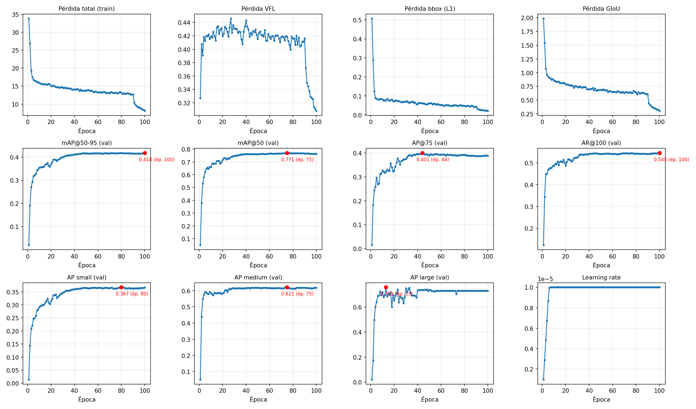
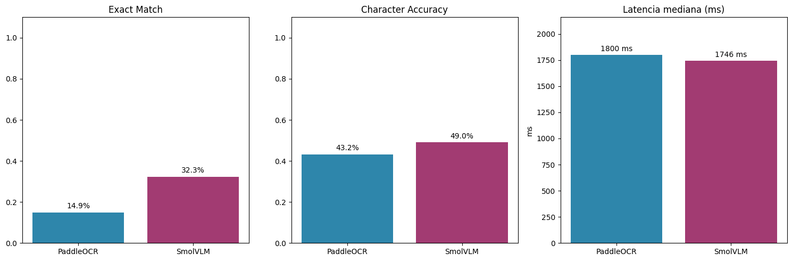

# Práctica 4 y Práctica 4b de Visión por Computador

## Componentes del grupo:

- Iván Luján Moreno ([@Darknight99V](https://github.com/Darknight99V))
- Carla Gómez García ([@carlagomez22](https://github.com/carlagomez22))

<br><br>

## Introducción

La práctica consta de dos tareas principales. La primera requiere de los siguientes puntos:

- Detección y seguimientos de personas y vehículos presentes.
- Detección de matrículas de los vehículos presentes.
- Cuenta total de cada clase.
- Volcado en disco de un vídeo que muestre los resultados.
- Generación de un archivo CSV con el resultado de la detección y seguimiento, con al menos los siguientes campos: fotograma, tipo_objeto, confianza, identificador_tracking, x1, y1, x2, y2, matrícula_en_su_caso, confianza, mx1,my1,mx2,my2, texto_matricula

  Adicionalmente, realizamos los siguientes apartados opcionales:
  - Determinación del flujo de personas y vehículos en el vídeo de test en las distintas direcciones.
  - Evaluación de alternativas para la detección de matrículas: una basada en YOLO y otra en RT-DETR.


Para la Práctica 4b, se piden los siguientes apartados:
  - Completar el CSV con la adquisición de texto de cada matrícula detectada.
  - Realizar una comparativa entre dos OCR, uno clásico y un VLM, en términos de tiempo de inferencia y tasa de acierto.

<br><br>

 ## Tarea 1

### Detección y seguimiento de personas y vehículos

Para la resolución se esta tarea, simplemente se usó el modelo preentrenado de YOLO (concretamente: yolo11n.pt). En su uso se especificaron las clases que se iban a detectar y además se usó la función de *track()* al ejecutar el modelo para poder hacer el seguimiento. Las clases utilizadas fueron las siguientes: *"person", "bicycle", "car", "motorbike", "bus" y "truck"*. A continuación se muestra cómo se usó el modelo:

```python
model.track(frame, persist=True, classes=[0,1,2,3,5,7], verbose=False)
```

Los resultados de estas detecciones se verán en el vídeo final que contiene todas las anotaciones de la práctica.

<br><br>

### Detección de matrículas

Para poder detectar matrículas, se propone en la práctica el entrenamiento de un modelo de YOLO. Para la obtención del dataset se dan varias opciones, pero finalmente el alumnado de la asignatura se ha coordinado para generar un pequeño [dataset](https://drive.google.com/drive/folders/1RFd6sKH_QMQcpE_w5rWmy8rKiYUY5_SI?usp=sharing) de alrededor de 2000 imágenes de matrículas. Dichas imágenes se encuentran en formato JPG en la carpeta *images* y sus respectivas anotaciones en la carpeta *annotations*.

Las anotaciones se realizaron utilizando un script de python ([script](https://drive.google.com/file/d/1Y8OJj8H2FHFxNMdYG62AEV5gN6-EbCAU/view?usp=drive_link)) desarrollado por uno de los compañeros. Estas anotaciones siguen la notación de YOLO normalizada y se guardaron en formato JSON:

```json
[
  {
    "rectangle": [
      0.6841878172588833,
      0.501269035532995,
      0.05208121827411161,
      0.02314720812182741
    ],
    "plate": "2221FXK"
  },
  {
    "rectangle": [
      0.4100761421319797,
      0.47446700507614215,
      0.02893401015228425,
      0.017461928934010162
    ],
    "plate": "None"
  }
]
```
 
 Como se puede observar, las anotaciones poseen el texto de la matrícula y el *bounding box* de cada una de las matrículas mayoritariamente legibles o reconocibles en cada imagen. Si una matrícula era reconocible pero su contenido no se legible, ya fuera por estar parcialmente tapada por otro objeto o estar muy lejos, el valor de la matrícula se ponía a *None*.

<br><br>

Antes de comenzar el entrenamiento, las imágenes se separaron en 3 conjuntos: train, test y val. El porcentaje de imágenes que posee cada carpeta con respecto al total de imágenes que tiene el dataset, respectivamente, es el siguiente: 64%, 20% y 16%.

Además, también fue necesario para cumplir con el formato que requiere YOLO para el entrenamiento, convertir las anotaciones de formato JSON a TXT, lo que se hizo con un pequeño script. Además, se adaptó para ser compatible con el formato requerido para RT-DETR.

```python
"""
Conversión JSON (YOLO normalizado) -> COCO + YOLO txt, con letterbox opcional.
Genera UN solo dataset de imágenes que usan ambos modelos (mismos píxeles):

OUT/
  train/images/*.jpg   train/labels/*.txt     <- YOLO (Ultralytics)
  val/...              test/...
  annotations/instances_{train,val,test}.json <- COCO (RT-DETR)
"""
import json
from pathlib import Path
from PIL import Image, ImageFile, ImageOps

Image.MAX_IMAGE_PIXELS = None          # permite abrir las imágenes gigantes

ROOT = Path('/content/data_raw/Datos_P4_split')
OUT  = Path('/content/dataset_coco')
IMG_EXT = {'.jpg', '.jpeg', '.png'}

MODE = 'letterbox'     # 'letterbox' (SIZE x SIZE con padding) | 'maxside' (solo reduce)
SIZE = 640
MAX_SIDE = 1920     
PAD_COLOR = (114, 114, 114)
JPEG_QUALITY = 95

truncadas = []


def procesar_imagen(src, dst):
    """Guarda la imagen procesada. Devuelve (W, H, w0, h0, s, px, py):
    tamaño final, tamaño original, escala y padding aplicados."""
    ImageFile.LOAD_TRUNCATED_IMAGES = False
    try:
        im = Image.open(src); im.load()
    except OSError:
        truncadas.append(src.name)
        ImageFile.LOAD_TRUNCATED_IMAGES = True
        im = Image.open(src); im.load()
        ImageFile.LOAD_TRUNCATED_IMAGES = False

    im = ImageOps.exif_transpose(im).convert('RGB')
    w0, h0 = im.size

    if MODE == 'letterbox':
        s = min(SIZE / w0, SIZE / h0)
        nw, nh = max(1, round(w0 * s)), max(1, round(h0 * s))
        im = im.resize((nw, nh), Image.LANCZOS)
        canvas = Image.new('RGB', (SIZE, SIZE), PAD_COLOR)
        px, py = (SIZE - nw) // 2, (SIZE - nh) // 2
        canvas.paste(im, (px, py))
        im, W, H = canvas, SIZE, SIZE
    else:
        s = min(1.0, MAX_SIDE / max(w0, h0))
        if s < 1.0:
            im = im.resize((round(w0 * s), round(h0 * s)), Image.LANCZOS)
        px = py = 0
        W, H = im.size

    im.save(dst, quality=JPEG_QUALITY)
    return W, H, w0, h0, s, px, py


def leer_anotaciones(lbl):
    """Devuelve lista de objetos o None si falta / es inválido."""
    if not lbl.exists():
        print(f'Sin JSON de anotaciones, se omite la imagen: {lbl.name}')
        return None
    try:
        with open(lbl) as f:
            return json.load(f)
    except json.JSONDecodeError as e:
        print(f'JSON inválido, se omite la imagen: {lbl.name} ({e})')
        return None


def build_split(name):
    img_src = ROOT / name / 'images'
    ann_src = ROOT / name / 'annotations'
    img_dst = OUT / name / 'images'
    lbl_dst = OUT / name / 'labels'
    (OUT / 'annotations').mkdir(parents=True, exist_ok=True)
    img_dst.mkdir(parents=True, exist_ok=True)
    lbl_dst.mkdir(parents=True, exist_ok=True)

    files = sorted(p for p in img_src.iterdir() if p.suffix.lower() in IMG_EXT)
    coco = {'images': [], 'annotations': [],
            'categories': [{'id': 0, 'name': 'plate'}]}
    img_id, ann_id = 0, 1
    omitidas = vacias = 0

    for p in files:
        objs = leer_anotaciones(ann_src / (p.stem + '.json'))
        if objs is None:              
            omitidas += 1
            continue

        img_id += 1
        out_name = p.stem + '.jpg'
        W, H, w0, h0, s, px, py = procesar_imagen(p, img_dst / out_name)
        coco['images'].append({'id': img_id, 'file_name': out_name,
                               'width': W, 'height': H})
        yolo_lines = []

        for obj in objs:
            xc, yc, w, h = obj['rectangle']       
            x1, y1 = max(0, (xc - w / 2) * w0), max(0, (yc - h / 2) * h0)
            x2, y2 = min(w0, (xc + w / 2) * w0), min(h0, (yc + h / 2) * h0)
            # a coordenadas de la imagen final (escala + padding)
            x1, x2 = x1 * s + px, x2 * s + px
            y1, y2 = y1 * s + py, y2 * s + py
            bw, bh = x2 - x1, y2 - y1
            if bw <= 1 or bh <= 1:
                continue
            coco['annotations'].append({
                'id': ann_id, 'image_id': img_id, 'category_id': 0,
                'bbox': [round(x1, 2), round(y1, 2), round(bw, 2), round(bh, 2)],
                'area': round(bw * bh, 2), 'iscrowd': 0})
            ann_id += 1
            yolo_lines.append(f'0 {(x1 + bw / 2) / W:.6f} {(y1 + bh / 2) / H:.6f} '
                              f'{bw / W:.6f} {bh / H:.6f}')

        if not yolo_lines:
            vacias += 1
        (lbl_dst / (p.stem + '.txt')).write_text('\n'.join(yolo_lines))

    with open(OUT / 'annotations' / f'instances_{name}.json', 'w') as f:
        json.dump(coco, f)
    print(f'{name}: {len(coco["images"])} imágenes, {len(coco["annotations"])} cajas, '
          f'{omitidas} omitidas (sin/!JSON), {vacias} sin ninguna caja')


if __name__ == '__main__':
    for s in ['train', 'val', 'test']:
        build_split(s)
    print(len(truncadas), 'imágenes truncadas')
    for n in truncadas:
        print(n)
```

Los parámetros usados para el entrenamiento del YOLO fueron los siguientes:

| Parámetro | YOLO-M (Ultralytics) |
| :--- | :--- |
| **Épocas** | 100 |
| **Optimizador** | `AdamW` 
| **LR** | ~`1e-3` |
| **Weight decay** | `5e-4` |
| **Warmup** | 3 épocas |
| **EMA** | Sí  |
| **Aumentos** | `mosaic` (desactivado las últimas 10 épocas con `close_mosaic`), `HSV`, `flip`, `scale` |
| **Early stopping** | `patience=30` |
| **Tamaño de imagen** | 640 |

Se usaron dichos hiperparámetros por varias razones:
1. Comparativa justa entre YOLO y RT-DETR.
2. Poder detectar matrículas situadas en la lejanía sin tener un nivel de detalle significativo que pudiese realentizar el entrenamiento.
3. Evitar el fenómeno *overfiting*.
4. Evitar el *early-stopping*.

Se eligieron 100 épocas debido a que los archivos de configuración oficiales usan 70-120 épocas. Por eso, se decidió usar un valor intermedio de 100 para poder hacer un *fine-tunning* aceptable y evitar que el modelo aprendiese de "memoria" el conjunto de entrenamiento. Se usaron 3 épocas de warmup para estabilizar los gradientes al inicio del entrenamiento, evitando que el optimizador AdamW diverja con el learning rate inicial. Las gráficas obtenidas de este entrenamiento son las siguientes:

**Matriz de confusión (YOLO)**:



Aunque el modelo confunde muchas matrículas con el resto de la imagen, se tiene la hipótesis de que ésto es debido a que la métrica es altamente restrictiva y aquellos *bounding boxes* que no se ajusten dentro del rango de mAP50-95.

<br><br>
**Resultados (YOLO)**:



Los resultados obtenidos demuestran una convergencia estable, con funciones de pérdida (box, cls y dfl) que disminuyen sin evidencia de sobreajuste significativo. Se puede apreciar que se alcanza una precisión del 90% y un *recall* de 70%. El mAP50 demuestra que, aunque no es capaz de delinear correctamente la matrícula, demostrado con el mAP50-95, si es capaz de ubicarla con bastante precisión. Esto puede ser debido no solo a características o fenómenos del entrenamiento si no de un fallo humano en las anotaciones que impide al modelo aprender mejor.

<br><br>

### Conteo por clases y flujo de personas y vehículos

 Por otro lado, para el conteo total de cada clase y su flujo, se fue contando *frame* a *frame* los distintos objetos que detectaba el modelo de YOLO y se analizaba la clase y el ID de cada uno. 
 Se contaba con con el número de clase como clave y el nombre de la clase como valor, y un *set* que contenía los distintos IDs detectados para dicha clase, y evitaba IDs duplicados, para realizar el conteo.

 Estas son las estructuras en las que se apoyó el conteo
 ```python
classCounter = {"person": 0, "bicycle": 0, "car": 0, "motorbike": 0, "bus": 0, "truck": 0}
classNames = {0: "person", 1: "bicycle", 2: "car", 3: "motorbike", 5: "bus", 7: "truck"}
uniqueObjects = {nombre: set() for nombre in classNames.values()}
```

En este fragmento del código se recorren los resultados obtenidos después de ejecutar el modelo en el frame actual para realizar el conteo.
```python
        for result in results:
            for box in result.boxes:
                clase = int(box.cls.item())

                if clase not in classNames:
                    continue

                nombre = classNames[clase]
                classCounter[nombre] += 1

                if box.id is not None:
                    id_objeto = int(box.id.item())
                    uniqueObjects[nombre].add(id_objeto)
```

Asimismo, para determinar el flujo de los objetos detectados y seguidos, se crearon dos objetos. El primero se usa para almacenar las coordenadas por las que ha ido pasando un objeto detectado por YOLO y poder calcular la predicción de su trayectoria, teniendo en cuenta su punto inicial y final. Luego, se utiliza un segundo objeto (*Image_Section*) para representar los cuadrantes de la imagen. Cada uno almacena una cuenta de los distintos objetos y sobreescribe el método "*__str__*" para poder mostrar de forma eficiente y clara los objetos que han "salido" de la imagen por esa sección.

```python
class Tracked_Object:

    def __init__(self, id : int, type : int) -> None:
        self.id = id
        self.points = [] # los distintos puntos asociados a este objeto
        self.trayectory_x = 0
        self.trayectory_y = 0
        self.type = type

    def add_point(self, xy) -> None:
        x, y = xy[0], xy[1]
        self.points.append((x, y))

    def calculate_trayectory(self) -> None:
        self.trayectory_x = self.points[-1][0] - self.points[0][0]
        self.trayectory_y = self.points[-1][1] - self.points[0][1]

    def __str__(self) -> str:
        return f"ID:{self.id}, type:{self.type}"

class Image_Section: 

    def __init__(self, section_name : str) -> None:
        self.name = section_name
        self.class_names = {0:"person", 1:"bicycle", 2:"car", 3:"motorbike", 5:"bus", 7:"truck"}
        self.detections = {} # par clave-valor clase : cuenta

    def add_obj(self, obj : Tracked_Object) -> None:
        self.detections[obj.type] = self.detections.get(obj.type, 0) + 1

    def __str__(self):
        total = sum(self.detections.values())
        string = f"Esta sección de {self.name} contiene {total} objetos:\n"
        for key, count in self.detections.items():
            string += f"- {self.class_names.get(key, f'clase_{key}')} : {count}\n"
        return string
```

Los objetos descritos anteriormente se usan en el código de la siguiente manera: se recorren los resultados obtenidos por YOLO y se adquieren los IDs, *bounding boxes* en formato YOLO y el tipo. Con estos datos, se crea un objeto en caso de no existir con dicho ID y se añaden las nuevas coordenadas al objeto. Más adelante, una vez termina el vídeo, se crean las 4 secciones de la imagen y por cada uno de los objetos creados, se calcula su trayectoria y se encaja en la sección correspondiente. Por último, se muestran los resultados de las predicciones. 

```python
  #video
  filename = "coches.MP4"
  
  #carga de los modelos
  model = YOLO('yolo11n.pt')
  last_known_position = {} 
  objects = {} # clave-par id:obj
  coches = cv2.VideoCapture(filename)
  
  while(True):
      if not ret:
          break
      
      results = model.track(frame, persist=True, classes=[0,1,2,3,5,7], verbose=False)
      frame = results[0].plot()
  
      #recorrer resultados
      for result in results:
          ids = result.boxes.id.int().cpu().tolist()
          boxes_xywh = result.boxes.xywh.cpu().tolist()
          types = result.boxes.cls.int().cpu().tolist()
  
          for id, coords, type in zip(ids, boxes_xywh, types):
              if id not in objects:
                  objects[id] = Tracked_Object(id, type)
              objects[id].add_point(coords)

  lu = Image_Section("arriba izquierda")
  ld = Image_Section("abajo izquierda")
  ru = Image_Section("arriba derecha")
  rd = Image_Section("abajo derecha")
  
  for id in objects.keys():
      obj = objects[id]
      obj.calculate_trayectory()
  
      if obj.trayectory_x < 0 and obj.trayectory_y < 0:
          ld.add_obj(obj)
      elif obj.trayectory_x < 0 and obj.trayectory_y > 0:
          lu.add_obj(obj)
      elif obj.trayectory_x > 0 and obj.trayectory_y > 0:
          ru.add_obj(obj)
      else:
          rd.add_obj(obj)
  
  print(objects)
  
  print(lu)
  print(ld)
  print(ru)
  print(rd)
```


```python
#video
filename = "coches.MP4"
ANCHO_MAX = 1280

#clases que se van a detectar
classCounter = {"person": 0, "bicycle": 0, "car": 0, "motorbike": 0, "bus": 0, "truck": 0}
classNames = {0: "person", 1: "bicycle", 2: "car", 3: "motorbike", 5: "bus", 7: "truck"}
uniqueObjects = {nombre: set() for nombre in classNames.values()}

#carga de los modelos
model = YOLO('yolo11n.pt')
last_known_position = {} 
coches = cv2.VideoCapture(filename)

while(True):
    ret, frame = coches.read()

    if ret:
        alto, ancho = frame.shape[:2]
        if ancho > ANCHO_MAX:
            factor = ANCHO_MAX / ancho
            frame = cv2.resize(frame, (ANCHO_MAX, int(alto * factor)))
        alto, ancho = frame.shape[:2]

        # Reiniciar contadores en cada frame
        classCounter = {nombre: 0 for nombre in classNames.values()}   

        results = model.track(frame, persist=True, classes=[0,1,2,3,5,7], verbose=False)
        frame = results[0].plot()

        #recorrer resultados
        for result in results:
            for box in result.boxes:
                clase = int(box.cls.item())

                if clase not in classNames:
                    continue

                nombre = classNames[clase]
                classCounter[nombre] += 1

                if box.id is not None:
                    id_objeto = int(box.id.item())
                    uniqueObjects[nombre].add(id_objeto)

            #Dibujar contador
        objetos = []

        for nombre in classNames.values():
            actual = classCounter[nombre]
            total = len(uniqueObjects[nombre])

            objetos.append(f"{nombre}: {actual} (Total: {total})")

        fuente = cv2.FONT_HERSHEY_SIMPLEX
        escala = 0.55
        grosor = 2
        margen = 10
        separacion = 25

        # Calcular dimensiones del panel
        dimensiones = [
            cv2.getTextSize(texto, fuente, escala, grosor)[0]
            for texto in objetos
        ]

        ancho_panel = max(w for w, h in dimensiones) + 20
        alto_panel = len(objetos) * separacion + 15

        # Situar panel en esquina superior derecha
        x_panel = max(0, ancho - ancho_panel - margen)
        y_panel = margen

        # Dibujar fondo negro
        cv2.rectangle(
            frame,
            (x_panel, y_panel),
            (x_panel + ancho_panel, y_panel + alto_panel),
            (0, 0, 0),
            -1
        )

        # Dibujar cada linea
        for i, texto in enumerate(objetos):

            x = x_panel + 10
            y = y_panel + 20 + i * separacion

            cv2.putText(
                frame,
                texto,
                (x, y),
                fuente,
                escala,
                (0, 255, 0),
                grosor,
                cv2.LINE_AA
            )
        cv2.imshow('Vid', frame)

    # Detenemos pulsado ESC
    if cv2.waitKey(20) == 27:
        break

coches.release()
```

Finalmente, se utilizaron ambos modelos (el preentrenado con las clases seleccionadas y el que se entrenó con matrículas) sobre el vídeo de prueba proporcionado por el profesorado. El código también integra el conteo por clases y el flujo de personas y vehículos anteriormente expuestos.

<br><br>
### Generación del CSV y volcado del vídeo en memoria
El código para la obtención del CSV se encuentra dentro del bucle que va ejecutando el vídeo de prueba frame a frame, ya que es en este momento en el que se obtienen los resultados de las inferencias realizadas con los modelos (YOLO básico y YOLO entrenado con matrículas), así como el PaddleOCR.

```python
result = results_yolo[0]
    boxes = result.boxes

    if boxes is not None and len(boxes) > 0:

        coordenadas_obj = boxes.xyxy.cpu().numpy()
        clases = boxes.cls.cpu().numpy()
        confianzas_obj = boxes.conf.cpu().numpy()

        # Obtener identificadores de tracking
        if boxes.id is not None:
            ids = boxes.id.int().cpu().numpy()
        else:
            ids = [None] * len(boxes)

        for i, box in enumerate(coordenadas_obj):

            x1, y1, x2, y2 = map(int, box)

            clase = int(clases[i])
            nombre = classNames[clase]

            confianza_obj = float(confianzas_obj[i])
            id_objeto = ids[i]

            # Buscar matrículas cuyo centro esté dentro del objeto
            matricula_asociada = None

            for mat in matriculas_detectadas:

                centro_x = (mat["mx1"] + mat["mx2"]) / 2
                centro_y = (mat["my1"] + mat["my2"]) / 2

                if x1 <= centro_x <= x2 and y1 <= centro_y <= y2:

                    # Si hay varias, quedarse con la de mayor confianza
                    if (
                        matricula_asociada is None
                        or mat["confianza"] > matricula_asociada["confianza"]
                    ):
                        matricula_asociada = mat

            # Preparar información de matrícula
            if matricula_asociada is not None:

                tiene_matricula = "Sí"

                confianza_mat = matricula_asociada["confianza"]

                mx1 = matricula_asociada["mx1"]
                my1 = matricula_asociada["my1"]
                mx2 = matricula_asociada["mx2"]
                my2 = matricula_asociada["my2"]

                texto_matricula = matricula_asociada["texto"]

            else:

                tiene_matricula = "No"

                confianza_mat = ""
                mx1 = ""
                my1 = ""
                mx2 = ""
                my2 = ""
                texto_matricula = ""

            # Escribir fila CSV
            writer.writerow({
                "fotograma": numero_fotograma,
                "tipo_objeto": nombre,
                "confianza_objeto": confianza_obj,
                "identificador_tracking": id_objeto if id_objeto is not None else "",
                "x1": x1,
                "y1": y1,
                "x2": x2,
                "y2": y2,
                "matricula_en_su_caso": tiene_matricula,
                "confianza_matricula": confianza_mat,
                "mx1": mx1,
                "my1": my1,
                "mx2": mx2,
                "my2": my2,
                "texto_matricula": texto_matricula
            })
```

El archivo resultante es similar al siguiente:


El archivo completo se encuentra en el respositorio [aquí](https://github.com/Darknight99V/VC/blob/958b2dc2a2f08982617be3564511ffeed3475c8e/P4/detecciones.csv)

En cuanto al volcado del vídeo en memoria, esto se realizó utilizando OpenCV, concretamente se utilizó el VideoWriter:

```python
# Crear el vídeo de salida
fourcc = cv2.VideoWriter_fourcc(*'mp4v')

out = cv2.VideoWriter(
    "resultado.mp4",
    fourcc,
    fps,
    (output_width, output_height)
)
```

El vídeo se encuentra en el siguiente [enlace](https://drive.google.com/file/d/1775CjsWIsBzE_HJ4rQobX8NI0ajlxb4s/view?usp=sharing)

<br><br>
### Comparación entre YOLO y RT-DETR

#### Entrenamiento de RT-DETR
De los diversos modelos RT-DETR disponibles en su [github](https://github.com/lyuwenyu/RT-DETR/tree/main), se escogió el de tamaño mediano (RT-DETRv2-M) para entrenarlo utilizando fine-tuning para que detecte matrículas. Los hiperparámetros escogidos para su entrenamiento tienen que ver con los de YOLO para que se pueda realizar una comparativa justa y porque ya venían en la configuración inicial definida por los autores en el repositorio.

| Parámetro | RT-DETR (Baidu) |
| :--- | :--- |
| **Épocas** | 100 |
| **Optimizador** | `AdamW` 
| **LR** | ~`1e-05` |
| **Weight decay** | `1e-4` |
| **Warmup** | 500 |
| **EMA** | sí  |
| **Aumentos** | `photometric distort`, `zoom out`, `IoU crop`, `multi-escala`; se desactivan hacia el final|
| **Early stopping** | no |
| **Tamaño de imagen** | 640 |

Antes de realizar el entrenamiento, se tuvo que hacer un preprocesado del dataset para hacer que las anotaciones estuvieran en formato COCO. Esto se realizó con el mismo script que se usó con las anotaciones de YOLO, como se mencionó anteriormente. Por otro lado, también fue necesario realizar un clonado del repositorio de RT-DETR en el disco de Google Colab.

Además, la configuración previa al entrenamiento incluye dos archivos: el primero de ellos corresponde a la configuración del modelo en sí, se incluyen los hiperparámetros antes descritos y una referencia al archivo de configuración del dataset; y el segundo indica dónde se ubica el dataset a utilizar, así como los subconjuntos en los que se encuentra dividido (train, val, test). Los archivos se deben ubicar en las siguientes rutas dentro del repositorio RT-DETR:

- `configs/rtdetrv2/rtdetrv2_r50vd_m_100e_plates.yml`
- `configs/dataset/plates_detection.yml`

Estas rutas a su vez se encuentran ubicadas en el directorio `rtdetrv2_pytorch`. Los contenidos de estos archivos de configuración se encuentran en el cuaderno correspondiente al entrenamiento de RT-DETR.

#### Métricas y puesta a prueba del modelo

Tras finalizar el entrenamiento, se utilizó un script que, a partir del archivo de log.txt generado durante dicho entrenamiento, obtuviera unas gráficas que permitieran la visualización de los resultados. Estos resultados se pueden observar en la siguiente imagen.



Por lo observado en estas gráficas, se podría obtener como conclusiones principales de este entrenamiento que no hay señales claras de sobreajuste y que ha logrado estabilidad y converger. Esto quiere decir que el entrenamiento con las condiciones actuales, es decir, la resolución usada y que el LR se mantiene fijo, no va a mejorar más si se hicieran más épocas. Como se observa en la gráfica AP Small, todavía le cuestan las detecciones de matrículas pequeñas ya que AP small tiene un valor de alrededor de 0.37 frente al 0.62 y 0.76 de AP medium y AP large respectivamente. Esto se puede deber a que al haber empleado imágenes de tamaño 640x640, las matrículas más pequeñas ocupan menos píxeles y quedan más ilegibles. Esto reduce el IoU (Intersection of Union) y se ven penalizadas por el modelo.


#### Comparativa con YOLO

En cuanto a la precisión de detección, pese a que RT-DETR presenta unos valores ligeramente superiores, una diferencia de aproximadamente 1,4 puntos de mAP@50-95. Sin embargo RT-DETR obtuvo mejor puntuación en mAP@50, lo que indica que detecta más matrículas con una localización aproximada.

Si se habla de convergencia, por lo comentado acerca de las gráficas, RT-DETR logra converger mucho más rápido que YOLO, que en sus últimas épocas seguía intentando mejorar mientras que RT-DETR se mantenía estable. 

Finalmente, se podría destacar el coste, ya que YOLO tardó 85 minutos mientras que RT-DETR tardó alrededor de 4h. Aunque en parte esto se deba a que RT-DETR cuenta con más parámetros, la diferencia sigue siendo significativa. 


<br><br>
## Tarea 2 (Práctica 4b)

 A la hora de completar esta tarea, se empezó seleccionando los OCR que se iban a comparar. El modelo clásico elegido fue PaddleOCR, debido a su modernidad y rendimiento en comparación a los otros OCR que se expusieron en el enunciado. Por otro lado, el modelo VML usado fue SmolVML, debido a su facilidad de uso y buen rendimiento en ámbitos generales, además de por su ligereza. Los resultado obtenidos con PaddleOCR en el vídeo se pueden observar tanto en el mismo vídeo como en el fichero CSV, analizando la última columna. 

### Comparativa de PaddleOCR y SmolOCR

 Para la comparativa, se creó un script que selecciona un número X de imágenes del subconjunto de datos de test y sus correspondientes JSON. Tras esto, recorta las secciones donde se encuentran las matrículas anotadas en los JSON. Luego, se procede a intentar extraer el texto del recorte y se mide tanto su precisión exacta como parcial como su tiempo de inferencia (latencia). Con precisión parcial se intenta medir qué tan bueno es el modelo detectando al menos un carácter de la matrícula correctamente. 

 ```python
# ============ PaddleOCR ============
print('\n[1/2] Ejecutando PaddleOCR...')
ocr = PaddleOCR(lang='es', use_textline_orientation=False, enable_mkldnn=False)

resultados_paddle = []
for i, (img_name, gt, crop) in enumerate(recortes):
    t0 = time.perf_counter()
    try:
        res = ocr.predict(np.array(crop))
        pred = ''
        if res:
            r0 = res[0]
            textos = r0.get('rec_texts', []) if isinstance(r0, dict) else getattr(r0, 'rec_texts', [])
            if textos:
                pred = str(textos[0]).strip().upper()
    except Exception as e:
        print(f'  PaddleOCR error en {img_name}: {e}')
        pred = ''
    t1 = time.perf_counter()
    resultados_paddle.append({'gt': gt, 'pred': pred, 'time': t1 - t0})
    if (i+1) % 50 == 0:
        print(f'  PaddleOCR: {i+1}/{len(recortes)}')

print(f'Resultados PaddleOCR recogidos: {len(resultados_paddle)}')

# ============ SmolVLM local ============
print('\n[2/2] Ejecutando SmolVLM local...')
resultados_smolvlm = []

try:
    from transformers import AutoProcessor, AutoModelForVision2Seq
    from transformers.image_utils import load_image

    model_name = "HuggingFaceTB/SmolVLM-256M-Instruct"
    print("Cargando SmolVLM (modelo ligero, debería ser rápido)...")
    
    processor = AutoProcessor.from_pretrained(model_name)
    model = AutoModelForVision2Seq.from_pretrained(
        model_name,
        torch_dtype=torch.bfloat16,
        device_map="auto"
    ).eval()

    def call_smolvlm(crop, model, processor):
        # Guardar el recorte temporalmente o pasarlo directamente como PIL Image
        # SmolVLM acepta PIL Image directamente en el processor
        messages = [
            {
                "role": "user",
                "content": [
                    {"type": "image"},
                    {"type": "text", "text": "What is the license plate number in this image? Answer only the plate characters, no extra text."}
                ]
            }
        ]
        
        t0 = time.perf_counter()
        try:
            # Aplicar plantilla de chat
            prompt = processor.apply_chat_template(messages, add_generation_prompt=True)
            
            # Preparar inputs: pasamos la imagen PIL directamente
            inputs = processor(text=prompt, images=[crop], return_tensors="pt")
            inputs = inputs.to(model.device)
            
            # Generar
            generated_ids = model.generate(**inputs, max_new_tokens=30)
            
            # Decodificar solo la parte generada (no el prompt)
            generated_text = processor.batch_decode(
                generated_ids[:, inputs["input_ids"].shape[1]:],
                skip_special_tokens=True
            )[0]
            
            # Limpiar: mayúsculas, solo letras/números/guiones
            pred_clean = re.sub(r'[^A-Z0-9\-]', '', generated_text.strip().upper())
        except Exception as e:
            print(f"Error en inferencia SmolVLM: {e}")
            pred_clean = ''
        t1 = time.perf_counter()
        
        return pred_clean, t1 - t0

    for i, (img_name, gt, crop) in enumerate(recortes):
        pred, dt = call_smolvlm(crop, model, processor)
        resultados_smolvlm.append({'gt': gt, 'pred': pred, 'time': dt})
        if (i+1) % 10 == 0:
            print(f'  SmolVLM: {i+1}/{len(recortes)}')
            torch.cuda.empty_cache()

except Exception as e:
    print(f"\nNo se pudo cargar/ejecutar SmolVLM: {e}")
    print("Se continuará solo con los resultados de PaddleOCR.")

# ============ Métricas ============
def exact_match(gt, pred):
    return int(gt == pred)

def char_accuracy(gt, pred):
    return SequenceMatcher(None, gt, pred).ratio()

def resumen(nombre, res):
    if not res:
        print(f'\n{nombre}: lista vacía, nada que calcular')
        return {'em': 0.0, 'ca': 0.0, 't_med': 0.0, 't_p95': 0.0}
    em = np.mean([exact_match(r['gt'], r['pred']) for r in res])
    ca = np.mean([char_accuracy(r['gt'], r['pred']) for r in res])
    t_med = np.median([r['time'] for r in res])
    t_p95 = np.percentile([r['time'] for r in res], 95)
    print(f'\n{nombre}:')
    print(f'  Exact Match: {em:.3f} ({em*100:.1f}%)')
    print(f'  Char Accuracy: {ca:.3f} ({ca*100:.1f}%)')
    print(f'  Latencia mediana: {t_med*1000:.1f} ms')
    print(f'  Latencia P95: {t_p95*1000:.1f} ms')
    return {'em': em, 'ca': ca, 't_med': t_med, 't_p95': t_p95}

r_paddle = resumen('PaddleOCR', resultados_paddle)
r_smolvlm = resumen('SmolVLM (Local)', resultados_smolvlm)

# Guardar resultados
with open(OUT_DIR / 'comparativa_ocr.pkl', 'wb') as f:
    pickle.dump({'paddle': resultados_paddle, 'smolvlm': resultados_smolvlm}, f)

# ============ Gráficas ============
fig, axes = plt.subplots(1, 3, figsize=(15, 5))

# Exact Match
axes[0].bar(['PaddleOCR', 'SmolVLM'], [r_paddle['em'], r_smolvlm['em']], color=['#2E86AB', '#A23B72'])
axes[0].set_title('Exact Match')
axes[0].set_ylim(0, 1.1)
for i, v in enumerate([r_paddle['em'], r_smolvlm['em']]):
    axes[0].text(i, v + 0.02, f'{v:.1%}', ha='center')

# Char Accuracy
axes[1].bar(['PaddleOCR', 'SmolVLM'], [r_paddle['ca'], r_smolvlm['ca']], color=['#2E86AB', '#A23B72'])
axes[1].set_title('Character Accuracy')
axes[1].set_ylim(0, 1.1)
for i, v in enumerate([r_paddle['ca'], r_smolvlm['ca']]):
    axes[1].text(i, v + 0.02, f'{v:.1%}', ha='center')

# Latencia mediana
t_paddle_ms = r_paddle['t_med'] * 1000
t_smolvlm_ms = r_smolvlm['t_med'] * 1000
axes[2].bar(['PaddleOCR', 'SmolVLM'], [t_paddle_ms, t_smolvlm_ms], color=['#2E86AB', '#A23B72'])
axes[2].set_title('Latencia mediana (ms)')
axes[2].set_ylabel('ms')
max_t = max(t_paddle_ms, t_smolvlm_ms)
if max_t > 0:
    axes[2].set_ylim(0, max_t * 1.2)
for i, v in enumerate([t_paddle_ms, t_smolvlm_ms]):
    axes[2].text(i, v + (max_t*0.02), f'{v:.0f} ms', ha='center')

plt.tight_layout()
plt.savefig(OUT_DIR / 'comparativa_ocr.png', dpi=150)
plt.show()
```

 Dichos resultados se pueden ver en la siguiente gráfica:

 

 Como se puede apreciar, SmolVML supera a PaddleOCR en todos los ámbitos, siendo la detección de la matrícula entera donde más sobrepasa a PaddleOCR con un 17.4% más de precisión. Cabe resaltar que esta métrica es altamente restrictiva. Sin embargo, las otras métricas demuestran que PaddleOCR no es mucho peor en términos de rendimiento y detección. Es posible que PaddleOCR sea más ligero si se usase otro modelo VML, como Unlimited-COR de Baidu. Adicionalmente, las métricas  se encuentran en el [archivo PKL](https://github.com/Darknight99V/VC/blob/4da0be1c451cfc951ec671fa4ba82b034169bee7/P4/comparativa_ocr.pkl).

 Para una comparación justa en latencia, se desactivaron optimizaciones como MKL-DNN y la orientación de línea de texto en PaddleOCR, asumiendo que las matrículas ya están recortadas y alineadas.

<br><br>
## Especificaciones hardware

 Las métricas en todos los apartados fueron sacadas de una máquina con GPU T4 en un Google Colab. 

  
